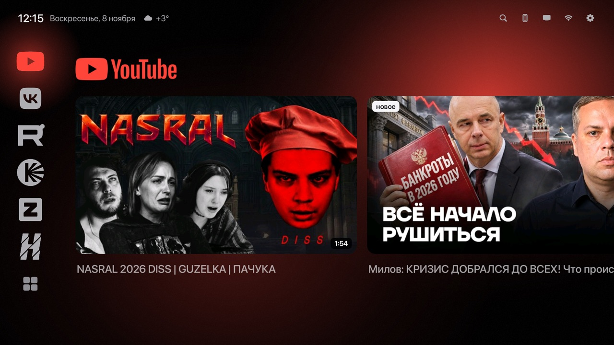
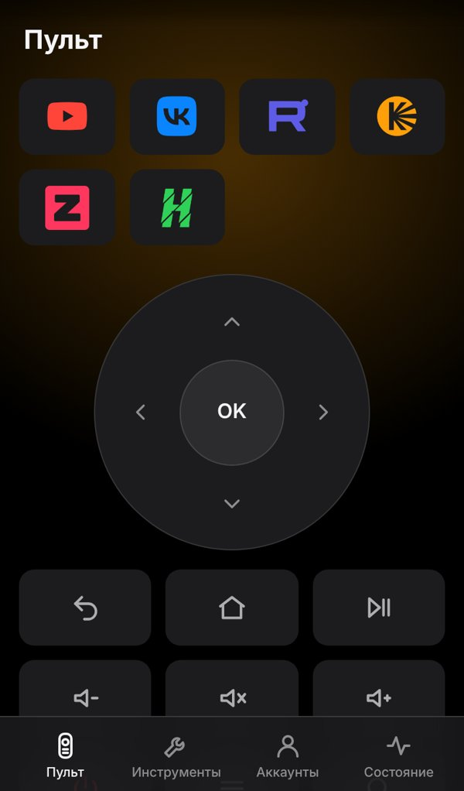
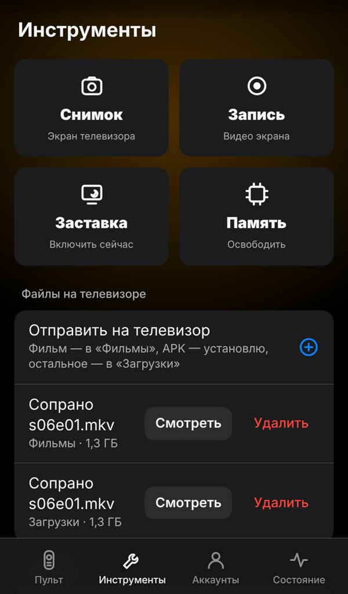
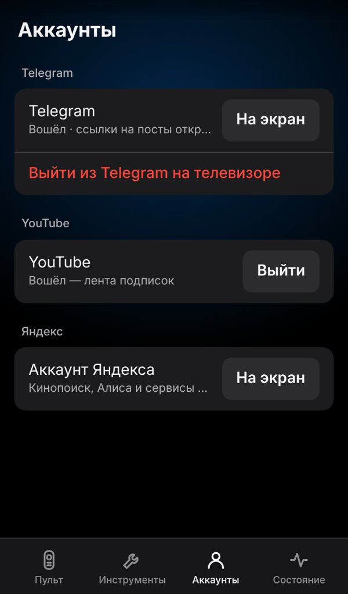
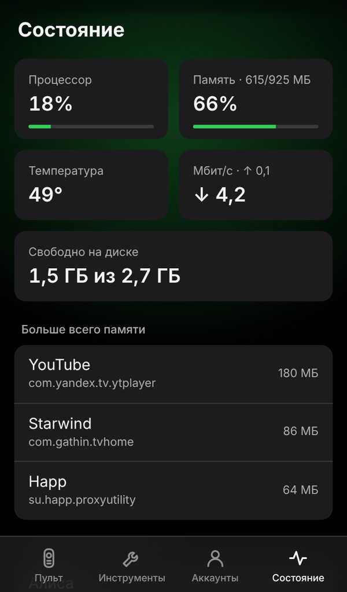

# Starwind TV — свой домашний экран для телевизора на Яндекс ТВ

Полная замена оболочки Яндекса на телевизоре **StarWind SW-LED43SG300** (Android 11, Яндекс ТВ, 1 ГБ памяти, без root)
на свой домашний экран в стиле Apple TV, плюс пульт в телефоне и свой клиент Telegram для длинных видео.
Всё ставится с Мака по сети одной командой, ничего не прошивается: убрать — тоже одной командой.



| Пульт | Инструменты | Аккаунты | Состояние |
|---|---|---|---|
|  |  |  |  |

## Что внутри

- **Главный экран** (`com.gathin.tvhome`, класс `IosHome`): вертикальный док сервисов слева, справа — живая лента
  выбранного сервиса (YouTube — подписки, ВК, Рутуб, Кинопоиск, Зона), ниже — все приложения.
  Логотип в фокусе загорается цветом сервиса, свет расходится по экрану. Погода, часы, поиск по всем сервисам, Wi‑Fi, настройки.
- **Боковое меню настроек**: тумблеры и выбор стрелками, Wi‑Fi, VPN (Happ), таймер сна, заставки, своя клавиатура,
  блокировка рекламы, быстрые анимации, обновление лаунчера с GitHub.
- **Семь заставок** (циферблаты, большие цифры, карта мира, виджеты, афиши, фото дня).
- **Своя экранная клавиатура** в том же стиле, с вводом текста с телефона.
- **Пульт в телефоне**: веб-страница с сервера на самом телевизоре (сохраняется на экран «Домой» iPhone как приложение).
  Кнопки и кликпад, док, ввод текста, ссылки на телевизор, снимок и запись экрана в «Фото», файлы и APK, настройки,
  аккаунты, состояние телевизора и всех приложений.
- **Свой плеер видео из Telegram** (TDLib): ссылка на пост с пульта — видео поста карточками, плеер с потоковой
  подкачкой, выбор качества, «продолжить просмотр», каналы. Вход по QR, весь трафик — только через VPN.
- **Единая дизайн-система** для телевизора и пульта: палитра iOS (тёмная), SF Pro, шкалы размеров, скруглений и отступов.
  Тесты не дают собрать сборку с цветом или отступом мимо системы.
- **Инструмент `tv`** на Маке: сборка, установка, проверка, журналы, разгрузка памяти, откат.

## Документация

| Документ | О чём |
|---|---|
| [Установка с нуля](starwind/docs/INSTALL.md) | Как повторить всё на другом таком же (или похожем) телевизоре |
| [Как пользоваться](starwind/docs/USAGE.md) | Телевизор, меню, заставки, VPN, ежедневное использование |
| [Пульт в телефоне](starwind/docs/REMOTE.md) | Установка на iPhone, вкладки, сохранение в «Фото», API сервера |
| [Telegram](starwind/docs/TELEGRAM.md) | Ключ API, вход, видео по ссылкам, плеер, ограничения |
| [Дизайн-система](starwind/docs/DESIGN.md) | Цвета, шрифты, размеры, правила для телевизора и пульта |
| [Устройство программы](starwind/docs/ARCHITECTURE.md) | Все части, процессы, права, файлы данных, классы |
| [Разработка](starwind/docs/DEVELOPMENT.md) | Сборка, тесты, установка, правила кода; как продолжать с любым ИИ |
| [Если что-то не так](starwind/docs/TROUBLESHOOTING.md) | Частые проблемы и решения |
| [История и решения](starwind/docs/HISTORY.md) | Почему сделано именно так, известные ограничения, идеи |

## Быстрый старт (Мак + телевизор в одной сети)

```bash
git clone https://github.com/timuramishov-jpg/starwind-tv.git ~/Documents/Claude/cleanyourtv
~/Documents/Claude/cleanyourtv/starwind/tv setup     # один раз: Java, Android SDK, адрес телевизора
~/Documents/Claude/tv deploy                          # собрать, поставить, сделать домашним экраном
```

Подробно, с подготовкой телевизора, ключами сервисов и шрифтами — в [INSTALL.md](starwind/docs/INSTALL.md).

## Основа

Проект вырос из открытого [CleanYourTV](https://github.com/Gathin23/cleanyourtv) (очистка Android TV от лишнего и свой
лаунчер). Исходный README того проекта — в [README.cleanyourtv.md](README.cleanyourtv.md); его инструменты (`tools/`)
используются для связи с телевизором по adb. Вся работа Starwind — в ветке `starwind` (здесь она основная):
папка [`starwind/`](starwind) и классы `Ios*`/`Tg*` в [`launcher/app/src/main/java/com/gathin/tvhome`](launcher/app/src/main/java/com/gathin/tvhome).
