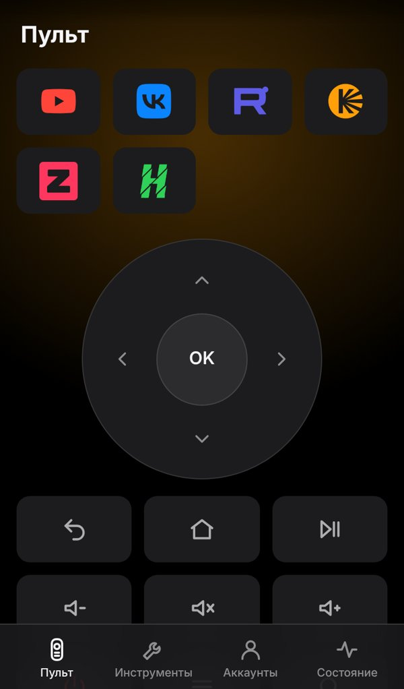
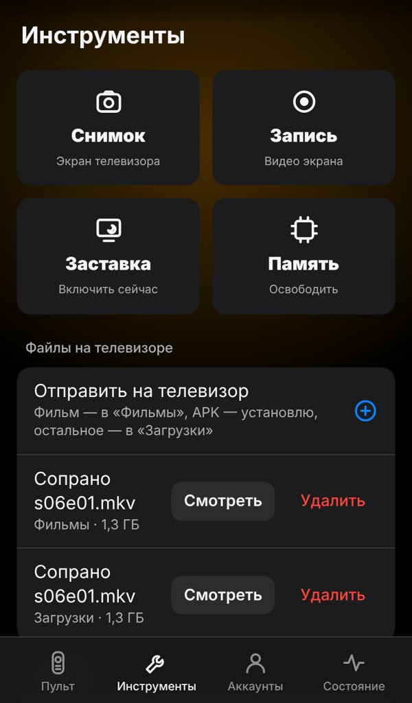
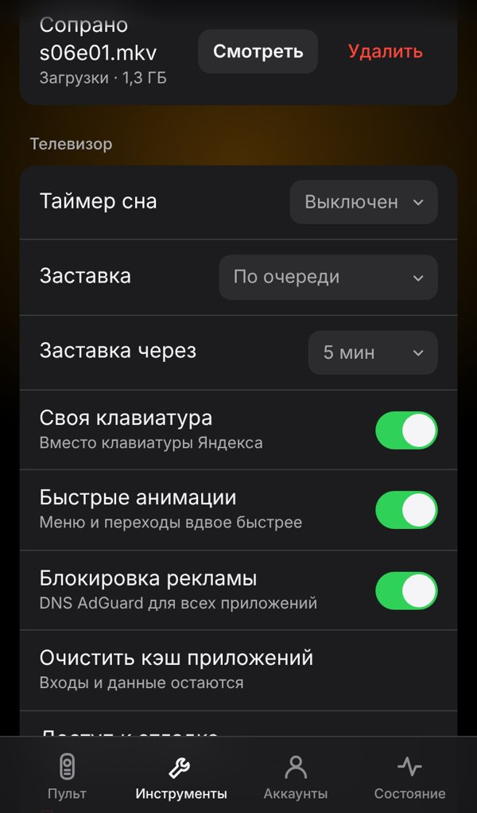
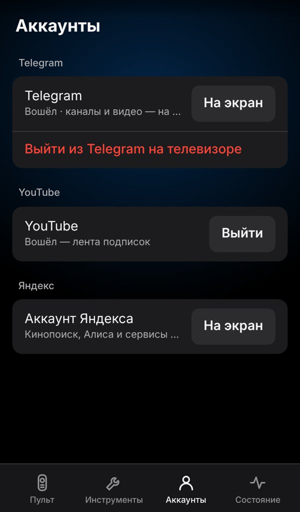
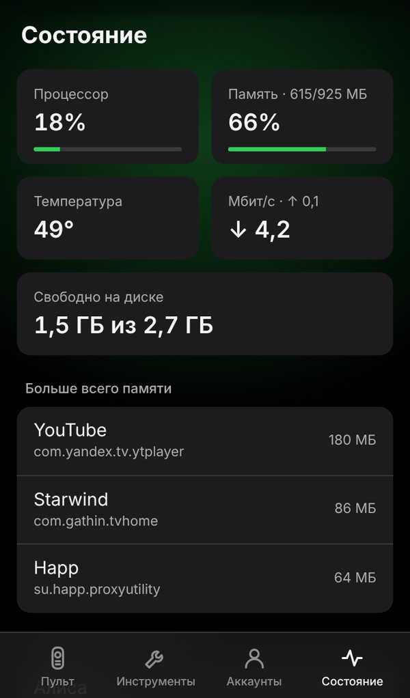

# Пульт в телефоне

Веб-страница, которую отдаёт сам телевизор (порт **8687**). Работает в домашней сети с любого телефона, на iPhone
сохраняется на экран «Домой» как приложение (своя иконка). Оформлена строго по [дизайн-системе](DESIGN.md) лаунчера.

## Как открыть

1. На главном экране телевизора — значок телефона вверху справа (или Настройки → «Пульт в телефоне»): появится QR-код.
2. Навести камеру телефона, открыть ссылку вида `http://192.168.x.x:8687/?k=КЛЮЧ`.
3. iPhone: «Поделиться» → «На экран „Домой“». Ключ запоминается, дальше страница открывается с иконки.

Ключ (`k`) — случайная строка, которую лаунчер создаёт при первом запуске; без него сервер ничего не делает (кроме иконки
и файла быстрой команды). Пароля нет — пульт рассчитан на домашнюю сеть.

## Вкладки

| Пульт | Инструменты | Инструменты (ниже) | Аккаунты | Состояние |
|---|---|---|---|---|
|  |  |  |  |  |

### Пульт
- **Док** — цветные логотипы сервисов, нажатие открывает приложение на телевизоре; выбранный подсвечен, фон пульта
  светится цветом сервиса. Восемь кнопок: сначала док телевизора (с Twitch), потом остальные приложения; менеджер
  файлов — последним (файлы и так есть во «Инструментах»).
- **Кликпад** как у Apple TV: стрелки и ОК.
- **Кнопки**: назад, домой, пауза/воспроизведение, тише, без звука, громче, выключить телевизор (красная), меню, поиск.
- **Поиск**: на YouTube — ищет в YouTube (открывает результаты), в остальном — общий поиск лаунчера.
- **Поле ввода** появляется само, когда на телевизоре открыта клавиатура (в любом приложении): печатай в телефоне,
  «Готово» — отправить. Каждое слово уходит после пробела.
- **Открыть на телевизоре** — вставить ссылку: YouTube, ВК, Рутуб, Telegram (посты открываются в своём клиенте) и любая страница.
- **VPN** — тумблер Happ и страна сервера.

Включить телевизор с телефона нельзя: во сне он отключает Wi‑Fi. Выключить — можно (кнопка питания).

### Инструменты
- **Снимок** экрана телевизора, **Запись** экрана (до 3 минут, 720p), **Заставка** — включить сейчас,
  **Память** — освободить (закрыть фоновые приложения).
- **Файлы на телевизоре**: «Отправить на телевизор» — любой файл; фильм уходит в «Фильмы», APK сразу ставится,
  остальное — в «Загрузки». Ниже список файлов: «Смотреть», «Удалить».
- **Телевизор**: таймер сна, стиль заставки, «Заставка через», своя клавиатура, быстрые анимации, блокировка рекламы
  (тумблеры и списки), очистить кэш, доступ к отладке, перезагрузить.
- **Этот телефон**: «Сразу сохранять в Фото» и установка быстрой команды (ниже).

### Аккаунты
- **Telegram**: состояние, «На экран»; при необходимости — поля api_id/api_hash и облачный пароль, «Выйти».
- **Twitch**: Client ID своего приложения (поле, пока ключа нет) → «Сохранить» — на телевизоре появится код входа;
  дальше «Войти»/«Выйти». Как получить Client ID — INSTALL.md, шаг 4.
- **YouTube**: вошёл ли (лента подписок), «Войти»/«Выйти» — процесс на экране телевизора.
- **Яндекс**: экран аккаунта Яндекса на телевизоре.

### Состояние
Процессор, память, температура, сеть, свободное место; кто занимает больше всего памяти; что можно смело отключить;
все установленные и встроенные приложения — остановить, очистить, отключить/включить, удалить.

## Снимки и записи в «Фото» автоматически

Страница в браузере не может сама записывать в «Фото», поэтому используется быстрая команда iOS:

1. «Инструменты» → «Установить команду „Starwind в Фото“» → открыть скачанный файл → «Добавить быструю команду».
   (Файл `launcher/app/src/main/assets/photos.shortcut` подписан на Маке: `shortcuts sign --mode anyone`.
   Команда: «Получить содержимое URL» из входных данных → «Сохранить в фотоальбом».)
2. Включить «Сразу сохранять в Фото».
3. При первом сохранении разрешить доступ к «Фото» и локальной сети.

Без команды снимок открывается крупно (долгое нажатие → «Сохранить в Фото»), видео — отдельной страницей.

## Как устроено

Страница — один файл [`launcher/app/src/main/assets/remote.html`](../../launcher/app/src/main/assets/remote.html)
(HTML+CSS+JS без библиотек). Сервер — [`IosShell.java`](../../launcher/app/src/main/java/com/gathin/tvhome/IosShell.java):
запускается от имени оболочки телевизора (`app_process`, как scrcpy), поэтому не умирает, когда системе не хватает
памяти, вводит кнопки напрямую и не уходит в VPN-туннель. Подробнее — [ARCHITECTURE.md](ARCHITECTURE.md#сервер-пульта-iosshell).

### Запросы сервера

Все — `GET /<команда>?k=КЛЮЧ&…` (кроме `upload` — `POST`), ответ — JSON `{"say": "…"}` или данные.

| Команда | Параметры | Что делает |
|---|---|---|
| `key` | `c` = имя KeyEvent без `KEYCODE_` | Нажать кнопку (`DPAD_UP`, `BACK`, `MEDIA_PLAY_PAUSE`, …) |
| `home` | | Домой |
| `power` | `on=0` | Выключить (кнопка питания) |
| `vol` | `d=up/down/mute` | Громкость |
| `text`, `type` | `t`, `done` | Ввод текста: в свою клавиатуру (`type`) или напрямую (`text`) |
| `apps`, `app`, `logo` | `p` = пакет | Док для пульта, открыть приложение, логотип |
| `open` | `u` = ссылка | Открыть ссылку (t.me — в клиент Telegram) |
| `search`, `ytsearch` | `q` | Поиск лаунчера / в YouTube |
| `vpn` | `on` | VPN |
| `saver`, `saverset` | `w`, `v` | Заставка: включить / стиль, задержка |
| `keyboard` | `on` | Своя клавиатура |
| `sleep` | `m` | Таймер сна (минуты, 0 — выкл) |
| `free` | | Освободить память |
| `tg` | `a=open/key/password/logout/feed`, `id`, `hash`, `p` | Telegram |
| `account` | `a=youtube/yandex` | Экраны аккаунтов на телевизоре |
| `state` | | Состояние (VPN, клавиатура, набор текста, Telegram, YouTube, заставка, таймер) |
| `stats`, `top`, `pkgs`, `pkg` | | Мониторинг и приложения |
| `install`, `files`, `upload`, `rm`, `get` | | APK и файлы |
| `shot`, `view` | | Снимок экрана (PNG / маленький JPEG) |
| `rec`, `video` | `a=start/stop/state` | Запись экрана и её отдача (с Range для Safari) |
| `tweak` | `w=anim/dns/trim/reboot/devsettings…` | Настройки телевизора |
| `/photos.shortcut`, `/icon.png` | — без ключа | Быстрая команда iOS, иконка |
