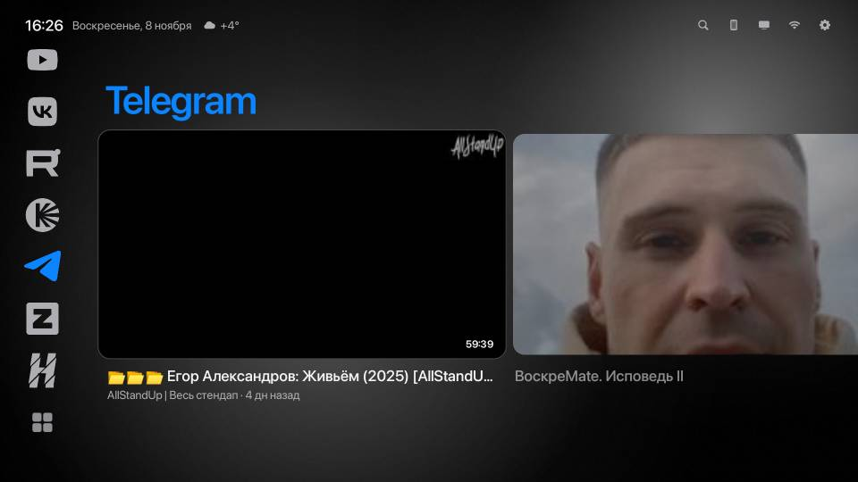
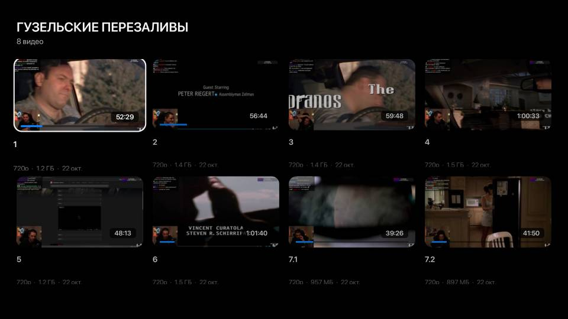
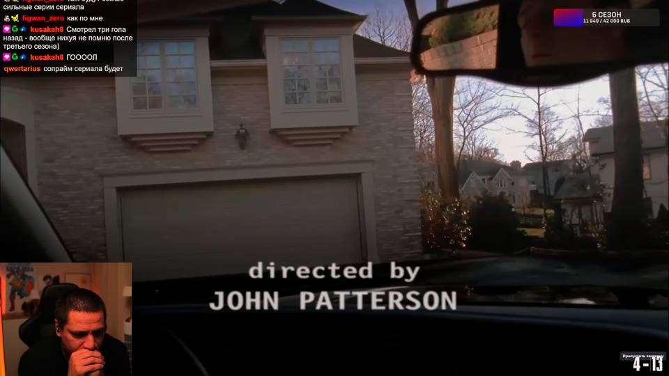

# Свой клиент Telegram для видео

Клиент заточен под одно: смотреть длинные видео из каналов (перезаливы стримов, фильмы, большие выпуски) на телевизоре
с пульта. Переписки нет. Работает на официальной библиотеке Telegram — **TDLib** (та же сборка, что в Telegram X),
в отдельном процессе `:tg`, чтобы не утяжелять главный экран. **Весь трафик — только через VPN**: если туннеля нет,
клиент встаёт на паузу и ничего не отправляет мимо него.

| Лента в доке | Видео поста | Плеер |
|---|---|---|
|  |  |  |

## Первый запуск

1. **Ключ API.** На [my.telegram.org](https://my.telegram.org) → «API development tools» создать приложение
   (название любое, платформа Android) и взять **api_id** (число) и **api_hash** (32 символа).
   С российским номером сайт часто отвечает «ERROR» или «Too many attempts»: помогли VPN через Казахстан
   (или Узбекистан) и пауза в несколько часов. Можно попросить ключ у человека с другим номером — ключ не даёт доступа к
   его аккаунту, входите вы своим.
2. **Ввести ключ** в пульте: «Аккаунты» → Telegram → api_id и api_hash → «Сохранить». Ключ уходит прямо на телевизор
   (хранится в настройках процесса `:tg`), в репозитории и на Маке его нет.
3. **Вход.** «На экран» — на телевизоре появится QR-код. В Telegram на телефоне: Настройки → Устройства →
   Подключить устройство, навести камеру. Если стоит облачный пароль — пульт попросит его.
4. После входа Telegram встаёт в док между Кинопоиском и Зоной (один раз; дальше порядок меняется как обычно).

## Что внутри

- **Главная клиента** (ОК на значке в доке): «Продолжить просмотр» и «Каналы с видео» — только каналы, где есть длинные видео.
- **Канал**: его видео карточками, подгружаются по мере листания.
- **Пост по ссылке**: пульт → «Открыть на телевизоре» → ссылка `t.me/канал/123` (или `t.me/c/…`) — все видео поста (альбом
  до 10 видео) карточками: превью, длительность, качество, размер, дата.
- **Лента в доке** (`TgFeed`): свежие видео из до 60 каналов, только длинные (**от 15 минут** или файлы **от 300 МБ**),
  не больше трёх с одного канала, до 24 карточек. Обновляется раз в 20 минут. Порог — `LONG_SECONDS`/`BIG_BYTES` в `TgFeed.java`.
- **Карточки**: ОК — смотреть; **Меню** — выбор качества, если Telegram сделал облегчённые версии; синяя полоска — сколько
  уже посмотрено.

## Плеер

- Системный плеер телевизора (`MediaPlayer`, аппаратное декодирование) + свой источник данных `TgSource`:
  файл целиком не скачивается, качается кусок вокруг места просмотра.
- ОК — пауза; ←/→ — 10 секунд назад / 30 вперёд (зажать — 60/120); ↑/↓ — показать полоску со временем.
- Место запоминается: открыл снова — продолжит. Досмотренное убирается из «Продолжить просмотр».
- После выхода из плеера скачанное стирается (на телевизоре ~1,5 ГБ свободного места); кэш Telegram ограничен 300 МБ.

### Как устроена подкачка (важно для доработок)

У больших видео служебная часть (`moov`) лежит в **конце файла**, и плеер не стартует, пока её не прочитает.
TDLib иногда «зависает» на отдельном куске на 10–30 секунд (видимо, медленное соединение через VPN), а без предела
раскидывает загрузку по всему файлу. Поэтому `TgSource`:

1. Просит у TDLib **окна по 64 МБ** от места чтения (`DownloadFile` с `offset` и `limit`), выровненные по куску 512 КБ.
2. **Сторож** раз в секунду смотрит, докуда файл скачан подряд от места просмотра, и держит **запас 48 МБ** впереди
   (≈1,5 минуты видео): следующий диапазон просится заранее, пока плеер доигрывает скачанное.
3. Если загрузка встала совсем (4 секунды ни байта) — отменяет и перезапускает.
4. Пока фокус на карточке видео больше секунды, `TgCore.prefetch` заранее качает **хвост (4 МБ) и начало (16 МБ)** —
   после ОК видео стартует почти сразу.
5. Готовые диапазоны читаются без запросов к TDLib (плеер делает тысячи мелких чтений).

Результат: серия на 1,2–1,5 ГБ стартует за 2–15 секунд и идёт без остановок; переход в нескачанное место — 10–20 секунд.

## Файлы

| Файл | Что |
|---|---|
| `TgCore.java` | TDLib: запуск, ключ, вход по QR, пароль, сеть только при VPN, запросы, подготовка видео |
| `TgActivity.java` | Экран клиента: вход, главная, канал, пост, карточки, выбор качества |
| `TgPlayerActivity.java` | Плеер |
| `TgSource.java` | Потоковая подкачка для плеера |
| `TgFeed.java` | Лента для дока и список «каналов с видео» |
| `TgReceiver.java` | Поручения с пульта (ключ, пароль, выход, лента) — только от оболочки (`DUMP`) и с ключом пульта |
| `TgLocal.java` | Лаунчер просит обновить ленту |
| `org/drinkless/tdlib/*` | Java-часть TDLib; нативная — `starwind/vendor/tdlib` |

Данные TDLib — `/data/data/com.gathin.tvhome/files/tg` (вход) и `cache/tg` (файлы). Состояние для пульта —
`/sdcard/Android/data/com.gathin.tvhome/files/remote/tg.json`.

## Почему не Telegram X / официальный клиент

Пробовали Telegram X: интерфейс для пальца (на стартовом экране пультом не нажать «Начать»), около 235 МБ памяти,
подтормаживания и вылеты на телевизоре с 1 ГБ. Свой клиент — только нужное, в дизайне лаунчера, ~90 МБ в своём процессе.
