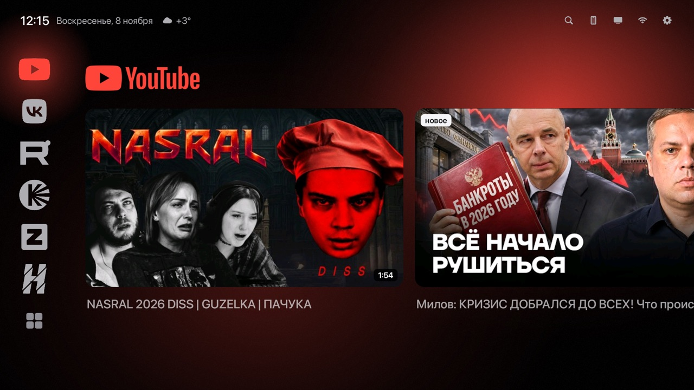
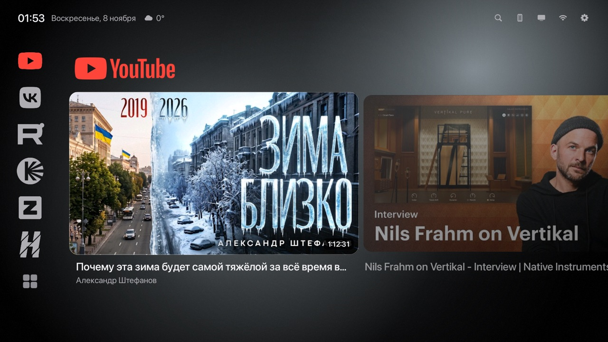
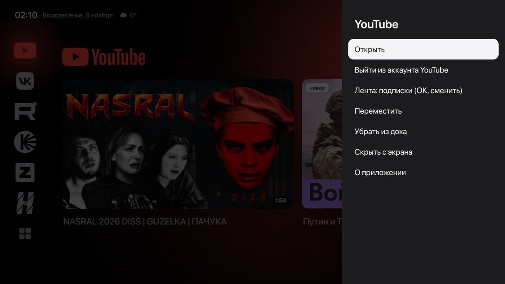
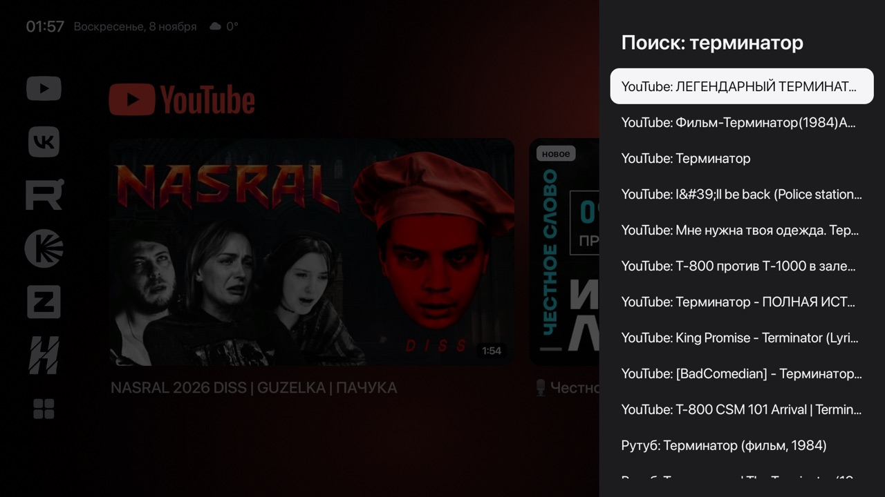
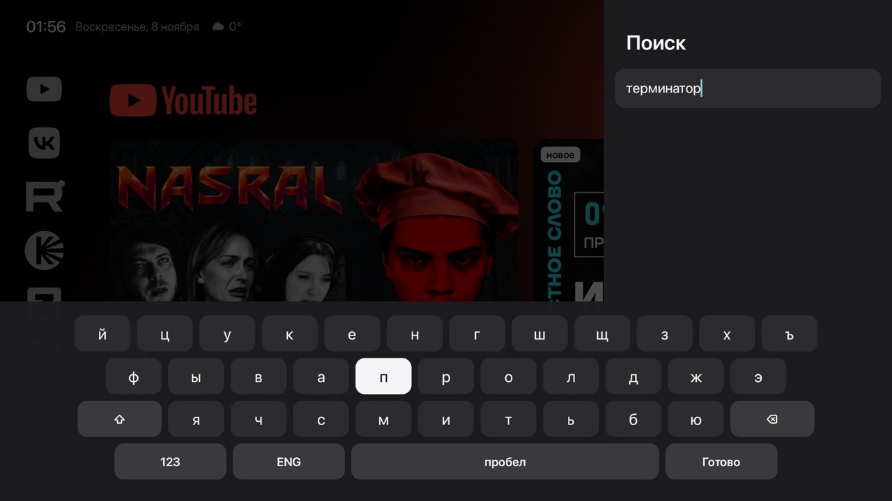
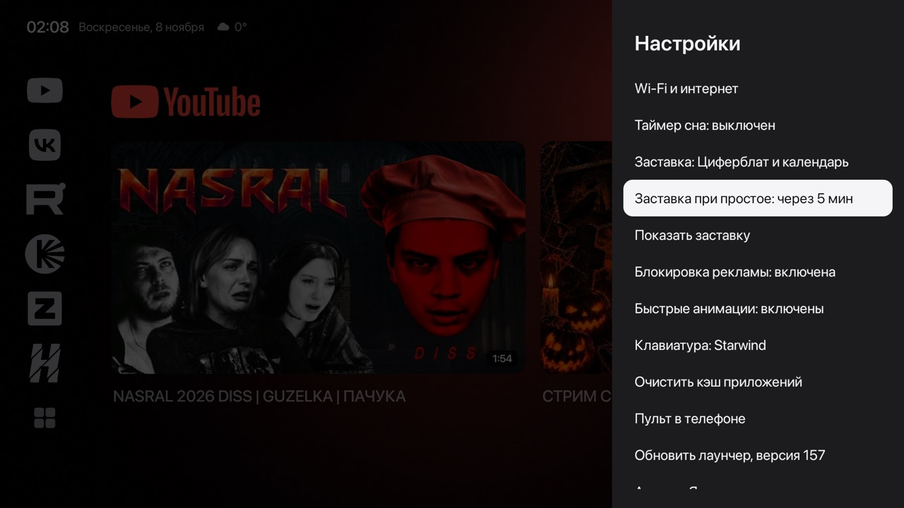
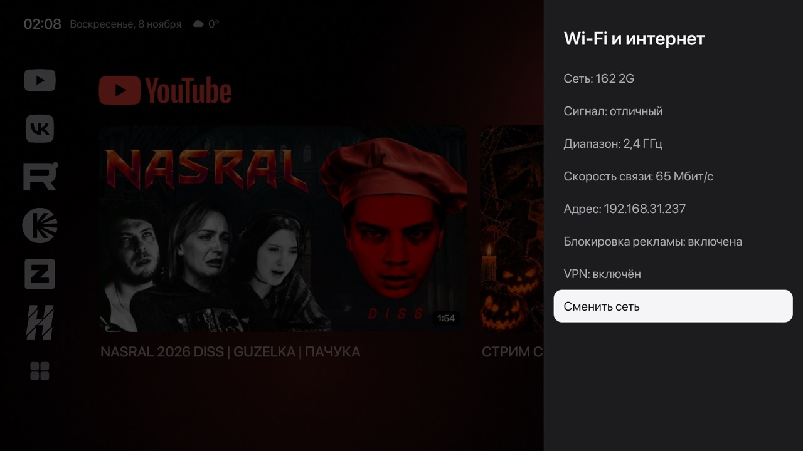

# Как пользоваться

## Главный экран

- **Слева — док сервисов.** Стрелки вверх/вниз выбирают сервис: логотип загорается его цветом, по экрану расходится
  свет, справа появляется лента этого сервиса. Последний пункт дока — все приложения.
- **Справа — лента выбранного сервиса:**
  - YouTube — новые видео из подписок (после входа) или популярное; шортсы отфильтрованы;
  - ВК Видео, Рутуб — рекомендации;
  - Кинопоиск — подборки (по ОК открывается приложение Кинопоиска);
  - Telegram — свежие **длинные** видео из каналов (от 15 минут или файлы от 300 МБ);
  - Зона — новинки.
  
  Вправо — по карточкам, ОК — открыть видео прямо в приложении сервиса. Метка «новое» — моложе суток.
- **Вниз** из ленты — ряд всех остальных приложений и плитка «Очистить память».
- **Вверху справа** — значки: поиск, пульт в телефоне (QR-код), источники (HDMI, телеканалы), Wi‑Fi, настройки.
  Вверху слева — часы, дата и погода.
- **Назад** — вернуться к доку. **Меню** (или долгое ОК) на приложении — меню приложения.

### Меню приложения

«Открыть», ленты (подписки / популярное / выключить), «Переместить» (стрелками по доку, ОК — готово), «Убрать из дока»,
«Скрыть с экрана», «О приложении». Скрытые возвращаются в настройках («Вернуть …»).

### Поиск

Лупа вверху: одна строка ищет сразу в YouTube, Рутубе и Кинопоиске. Текст можно набрать на экранной клавиатуре или с
телефона — на пульте само появится поле ввода. Недавние запросы запоминаются.

### Своя клавиатура

Русская, английская и цифры, клавиши-пилюли в стиле лаунчера; поля телефона и кода сразу открываются на цифрах.
Работает во всех приложениях, кроме YouTube (у него своя). Переключить на клавиатуру Яндекса — в настройках
(«Клавиатура») или на пульте. После обновления лаунчера выбранная клавиатура восстанавливается сама.

## Настройки

Шестерёнка вверху справа (или кнопка настроек на пульте). Переключатели с двумя состояниями — тумблеры, где вариантов
больше — выбор стрелками влево/вправо.

| Пункт | Что делает |
|---|---|
| Wi‑Fi и интернет | Сеть, сигнал, скорость, адрес, VPN; «Сменить сеть» — системный экран Wi‑Fi |
| Таймер сна | Выключен / 15 / 30 / 60 / 90 / 120 минут; за минуту предупреждение, потом экран гаснет. Работает, даже когда открыто другое приложение |
| Заставка | Какая: по очереди или одна из семи |
| Заставка при простое | Через сколько минут простоя на главном экране |
| Показать заставку | Включить сейчас (влево/вправо — листать стили, любая другая кнопка — выйти) |
| Блокировка рекламы | Частный DNS AdGuard для всех приложений |
| Быстрые анимации | Системные анимации вдвое быстрее |
| Клавиатура | Своя (Starwind) или Яндекса |
| Очистить кэш приложений | Чистит кэш всех приложений, входы и данные остаются |
| Пульт в телефоне | QR-код страницы пульта |
| Обновить лаунчер | Берёт последнюю сборку из релизов GitHub, телевизор один раз спросит «Установить?» |
| Аккаунт Яндекса, Системные настройки (звук, изображение, приложения) | Системные экраны |
| Вернуть … | Вернуть скрытые приложения |

## VPN (Happ)

Карточка Happ в доке открывает экран VPN: тумблер, связь (отклик, скорость) и сервер (страна). Включить/выключить можно и
с пульта (вкладка «Пульт»). Happ заворачивает в туннель все приложения, кроме себя. Telegram без VPN не работает
намеренно (ставится на паузу, пока VPN нет). `tv route on` — VPN только для YouTube и Google, `tv route off` — для всего.

## Заставки

Семь стилей: циферблат с календарём, прямоугольный циферблат, большие цифры, карта мира, виджеты, афиши кино, фото дня.
Включаются сами после простоя на главном экране (по умолчанию через 5 минут), а также системой как заставка телевизора.

## Источники

Значок «Источники» или кнопка INPUT пульта: HDMI-входы и телеканалы. Если подключить приставку или ноутбук, лаунчер
предложит перейти на этот вход (подсказка 15 секунд, ОК — перейти).

## Память

На телевизоре всего ~925 МБ. Лаунчер сам закрывает фоновые приложения, когда возвращаешься на главный экран при нехватке
памяти (кроме того, из которого вышел, VPN и Кинопоиска). Вручную — плитка «Очистить память» внизу или пульт → «Инструменты» → «Память».

## Пульт в телефоне и Telegram

- [REMOTE.md](REMOTE.md) — пульт: кнопки, ввод текста, ссылки, снимки и запись экрана, файлы, настройки, аккаунты, состояние.
- [TELEGRAM.md](TELEGRAM.md) — Telegram: каналы, лента, посты по ссылке, плеер.

## Команды на Маке (`~/Documents/Claude/tv`)

| Команда | Что делает |
|---|---|
| `tv setup` | Подготовить Мак с нуля (один раз) |
| `tv deploy` | Собрать и поставить; `QUIET=1 tv deploy` — тихо, не уводя с текущего экрана |
| `tv check` | Состояние: домашний экран, что на экране, VPN, память, падения |
| `tv report` | То же плюс журнал лаунчера в `report.txt` |
| `tv log [N]` | Последние строки журнала |
| `tv shot [имя]` | Снимок экрана в `shots/` |
| `tv keys` | Передать ключи из `secrets.json` |
| `tv install F.apk` / `tv uninstall пакет` | Поставить / удалить приложение |
| `tv aurora` | Поставить Aurora Store |
| `tv slim` / `tv rollback` | Выключить оболочку Яндекса / вернуть её |
| `tv lighten` / `tv lighten off` | Разгрузить фон / вернуть |
| `tv route on/off` | VPN только для YouTube / для всего |
| `tv backup` | Копия настроек лаунчера в `backup/` |
| `tv release` | Выложить собранный APK в релизы GitHub (телевизоры обновятся из меню) |
| `tv agent` / `tv agent install` | Режим, в котором ИИ-помощник сам выполняет команды (см. DEVELOPMENT.md) |
| `tv adb off` | Выключить отладку по сети |
| `tv reboot` | Перезагрузить телевизор |
